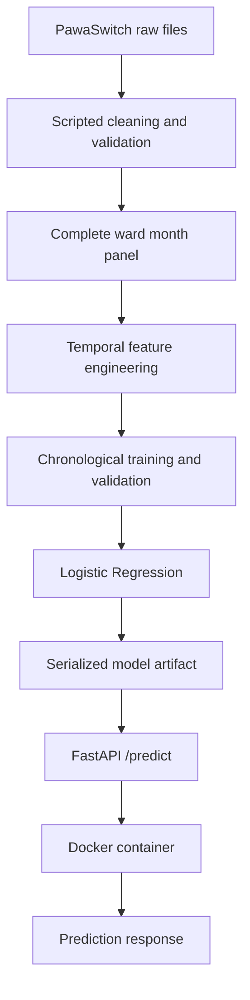

# PowerCast Kenya

## Predicting Next Month Planned Electricity Interruption Risk Across Kenyan Wards

PowerCast Kenya is an end to end Applied Machine Learning capstone that predicts whether a ward represented in the PawaSwitch data will have at least one **mapped planned electricity interruption notice in the following month**.

The project predicts planned interruption notices, not all physical or unplanned blackouts.

## 1. Project overview

**Problem type:** supervised binary classification  
**Observation:** one ward in one month  
**Target:** 1 when the ward has at least one mapped planned interruption in the following month, otherwise 0  
**Final model:** Logistic Regression, L2 regularization, `C=0.02`  
**Decision threshold:** selected from the July to December 2025 validation period  
**Final evaluation period:** January to September 2026

The raw snapshot contains 6,795 planned interruption event records. The modelling pipeline creates a complete ward month panel for 1,109 represented wards and builds temporal features from interruption history, duration, seasonality, population and county.

## 2. Repository structure

```text
powercast_kenya_REQUIRED_DELIVERABLES/
├── README.md
├── AI_USE.md
├── requirements.txt
├── Dockerfile
├── docker-compose.yml
├── src/
│   ├── config.py
│   ├── data_pipeline.py
│   └── train.py
├── models/
│   ├── best_model.joblib
│   └── model_metadata.json
├── api/
│   └── main.py
├── data/
│   ├── raw/
│   └── processed/
└── reports/
    └── PowerCast_Kenya_Final_Capstone_Report.docx
```

The `requirements.txt`, data files and model metadata are runtime support files needed to reproduce and serve the seven assessed deliverables.

## 3. Architecture diagram



## 4. Setup

From the repository root:

```bash
python -m venv .venv
```

Windows:

```bash
.venv\Scripts\activate
```

macOS/Linux:

```bash
source .venv/bin/activate
```

Install dependencies:

```bash
pip install -r requirements.txt
```

## 5. Reproduce the data pipeline

The raw files are under `data/raw/`:

- `events.csv`
- `event_wards.csv`
- `localities_matched.csv`
- `ward_stats_monthly.csv`
- `areas.geojson`

Run:

```bash
python -m src.data_pipeline
```

This regenerates:

- `data/processed/ward_month_feature_store.csv`
- `data/processed/model_dataset.csv`

The pipeline uses January 2022 onward as historical warm up data and retains March 2023 onward for modelling.

## 6. Reproduce model training

After the data pipeline finishes, run:

```bash
python -m src.train
```

This trains the chosen Logistic Regression approach, selects the classification threshold from the July to December 2025 validation period, refits the model on all pre-2026 development observations and writes:

- `models/best_model.joblib`
- `models/model_metadata.json`

The final report documents why Logistic Regression was retained over Random Forest and XGBoost, including class imbalance experiments and validation results.

## 7. Run the API locally

```bash
uvicorn api.main:app --reload
```

Open:

```text
http://127.0.0.1:8000/docs
```

Useful endpoints:

- `GET /health`
- `GET /model-info`
- `GET /wards`
- `POST /predict`

Example request:

```json
{
  "ward_code": "ainabkoi--ainabkoi-olare",
  "as_of_month": "2026-08"
}
```

## 8. Run with Docker

Make sure Docker Desktop is running, then execute:

```bash
docker compose up --build
```

Open:

```text
http://localhost:8000/docs
```

Stop the service with:

```bash
docker compose down
```

## 9. Final model results

The selected Logistic Regression achieved approximately:

- Validation PR AUC: **0.410**
- Final 2026 PR AUC: **0.356**
- Final 2026 ROC AUC: **0.693**
- Brier score: **0.117**
- Precision: **0.240**
- Recall: **0.635**
- F1 score: **0.349**
- Balanced accuracy: **0.637**

XGBoost performed slightly better on the later 2026 evaluation period, but the deployed model was not changed after the final evaluation because Logistic Regression had already won the predeclared 2025 validation comparison.

## 10. Main limitations

- The data describe planned announced interruptions, not every real electricity outage.
- Ward mapping is incomplete, so an unmapped interruption cannot be assigned reliably to a ward.
- The model covers wards represented in the supplied PawaSwitch snapshot rather than every ward in Kenya.
- The supplied monthly statistics contain 45 counties; Wajir and Mandera are absent.
- Temporal patterns and extraction coverage can change over time.

## 11. Required deliverables included

1. `README.md` — overview, setup, architecture and reproduction instructions.
2. `AI_USE.md` — disclosure of AI assistance.
3. `src/data_pipeline.py` — scripted reproducible data pipeline.
4. `src/train.py` + `models/best_model.joblib` — training code and serialized final artifact.
5. `Dockerfile` + `docker-compose.yml` — container deployment.
6. `api/main.py` — FastAPI model service.
7. `reports/PowerCast_Kenya_Final_Capstone_Report.docx` — final report covering problem framing, technique justification, results and limitations.
